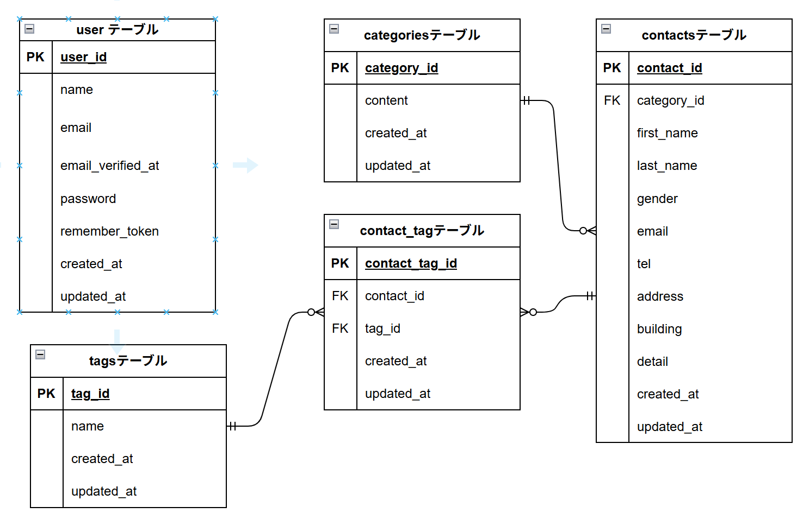

# COACHTECH お問い合わせフォーム

## 目的

確認テストを通して、教材で学んだバックエンド技術（Laravel, DB設計, テスト）を実践的にアウトプットし、復習箇所を洗い出すこと

## 概要

本システムは、一般ユーザーが利用する公開のお問い合わせフォームです。
誰でもお問い合わせを送信でき、管理者はログイン後にその内容を確認・管理します。

## 主な機能

- 一般：お問い合わせ入力フォーム（バリデーション機能付き）
- 一般：入力内容の確認・修正画面
- 一般：送信完了画面
- 管理：管理者ログイン機能（Fortifyによる認証）
- 管理：お問い合わせ一覧・詳細表示機能（検索・ページネーション付き）
- 管理：タグ追加・削除・編集機能
- 管理：データのエクスポート機能（CSV出力）

## ER図



## 環境構築手順

このプロジェクトは、Laravel 10.x と Laravel Sail（Docker環境）を使用して構築されています。以下の手順に従って環境を構築してください。

## 1. Laravelプロジェクトの作成 (Laravel 10.x)

以下のDockerコマンドを実行して、Laravel 10.x を明示的に指定してプロジェクトを作成します。

```bash
docker run --rm \
 -u "(id -u):(id -g)" \
 -v "\$(pwd):/var/www/html" \
 -w /var/www/html \
 -e COMPOSER_CACHE_DIR=/tmp/composer_cache \
 laravelsail/php82-composer:latest \
 composer create-project laravel/laravel:^10.0 contact-form-app
```

## 2. Laravel Sailのインストール

プロジェクト作成後、`contact-form-app` ディレクトリに移動し、Laravel Sailをインストールします。

## 2-1. プロジェクトディレクトリへの移動とSailのインストール

プロジェクトディレクトリに移動

```bash
cd contact-form-app
```

### Laravel Sailをインストール

```bash
docker run --rm \
 -u "(id -u):(id -g)" \
 -v "\$(pwd):/var/www/html" \
 -w /var/www/html \
 -e COMPOSER_CACHE_DIR=/tmp/composer_cache \
 laravelsail/php82-composer:latest \
 composer require laravel/sail --dev
```

## 2-2. Sail設定ファイルのパブリッシュ

```bash
docker run --rm \
    -u "(id -u):(id -g)" \
    -v "\$(pwd):/var/www/html" \
    -w /var/www/html \
    -e COMPOSER_CACHE_DIR=/tmp/composer_cache \
    laravelsail/php82-composer:latest \
    php artisan sail:install --with=mysql
```

### 💡 Apple Silicon（M1/M2/M3）Macをお使いの方へ

Apple Silicon搭載のMacでは、`sail up -d` 実行時に `no matching manifest for linux/arm64/v8` というエラーが発生する場合があります。

**解決方法:** `compose.yaml` を開き、`mysql` サービスに `platform: 'linux/amd64'` を追記してください。

```yaml
mysql:
    image: "mysql/mysql-server:8.0"
    platform: "linux/amd64" # ← この行を追加
    ports:
```

---

## 3. .env ファイルの設定

`.env` ファイルを開き、データベース接続情報が以下と一致していることを確認・修正します。

```env
DB_CONNECTION=mysql
DB_HOST=mysql
DB_PORT=3306
DB_DATABASE=laravel
DB_USERNAME=sail
DB_PASSWORD=password
```

> [!IMPORTANT]
> `DB_HOST` は `localhost` や `127.0.0.1` ではなく、Dockerコンテナ名である **`mysql`** を指定します。

---

## 4. phpMyAdminの追加

`compose.yaml` を開き、`mysql` サービスの後に以下の `phpmyadmin` の設定を追加してください。

```yaml
phpmyadmin:
    image: "phpmyadmin:latest"
    ports:
        - '\${FORWARD_PHPMYADMIN_PORT:-8080}:80'
    environment:
        PMA_HOST: mysql
        PMA_USER: '\${DB_USERNAME}'
        PMA_PASSWORD: '\${DB_PASSWORD}'
    networks:
        - sail
    depends_on:
        - mysql
```

---

## 5. Sailの起動とエイリアス設定

### 5-1. Sailをバックグラウンドで起動

```bash
./vendor/bin/sail up -d
```

### 5-2. エイリアスの設定（任意）

毎回 `./vendor/bin/sail` と入力する手間を省くため、`sail` だけで実行できるようにエイリアスを設定します。

**Zsh（Macのデフォルトなど）の場合:**

```bash
echo "alias sail='[ -f sail ] && bash sail || bash vendor/bin/sail'" >> ~/.zshrc
exec \$SHELL
```

**Bashの場合:**

```bash
echo "alias sail='[ -f sail ] && bash sail || bash vendor/bin/sail'" >> ~/.bashrc
exec \$SHELL
```

---

## 6. アプリケーションキーの生成

プロジェクトのルートディレクトリで以下のコマンドを実行し、アプリケーションキーを生成します。

```bash
sail artisan key:generate
```

---

## 7. フロントエンドのセットアップ (Vite & Tailwind CSS)

本プロジェクトでは、フロントエンドのスタイリングに Tailwind CSS を使用します。

> [!IMPORTANT]
> `sail npm` コマンドを実行する前に、**必ずSailコンテナが起動していること**を確認してください。

### 7-1. パッケージのインストールと初期化

```bash
# 1. NPM依存パッケージのインストール
sail npm install
```

# 2. Tailwind CSS と Alpine.js のインストール

```bash
sail npm install -D tailwindcss@^3.4.0 postcss autoprefixer
sail npm install alpinejs
```

# 3. 設定ファイルの生成

```bash
sail npx tailwindcss init -p
```

### 7-2. Tailwind CSS のテンプレートパス設定

`tailwind.config.js` を開き、`content` 部分を以下のように修正します。

```javascript
/** @type {import('tailwindcss').Config} */
export default {
    content: [
        "./resources/**/*.blade.php",
        "./resources/**/*.js",
        "./resources/**/*.vue",
    ],
    theme: {
        extend: {},
    },
    plugins: [],
};
```

### 7-3. 提供リポジトリの resources ディレクトリと入れ替え

以下の手順で、テンプレートとなる `resources` ディレクトリを差し替えます。

1. 別の作業用ディレクトリ等で提供リポジトリをクローンします。
    ```bash
    git clone https://github.com/coachtech-prepared-file/Preparedblade-ConfirmationTest-ContactForm.git
    ```
2. Finderで現在のプロジェクトフォルダを開きます。
    ```bash
    open .
    ```
3. プロジェクト内にある既存の `resources` フォルダを削除します。
4. クローンしたリポジトリ内にある `resources` フォルダを、プロジェクトの直下にコピーして配置します。

> [!TIP]
> コマンド操作に慣れている場合は `rm -rf` と `cp -r` でも可能ですが、誤削除を防ぐためFinderでの操作を推奨します。

### 7-4. Vite開発サーバーの起動

```bash
sail npm run dev
```

> [!NOTE]
> `sail npm run dev` は変更をリアルタイムに反映させるため、**実行したまま（ターミナルを開いたまま）**にしておく必要があります。

---

## 8. データベースのマイグレーションと初期データ投入

最後に、以下のコマンドでデータベースのテーブルを作成し、初期（シード）データを投入します。

```bash
sail artisan migrate --seed
```

### 💡 データベースをリセットしたい場合

開発中にデータを初期状態に戻したい場合は、以下のリセットコマンドを実行してください。

```bash
sail artisan migrate:fresh --seed
```

## 🛠️ 使用技術 (Tech Stack)

本プロジェクトでは、以下の技術・環境を使用しています。

### バックエンド (Backend)

- **PHP**: 8.2
- **Laravel**: 10.x
- **Composer**: パッケージ管理ツール

### フロントエンド (Frontend)

- **Vite**: フロントエンドビルドツール
- **Tailwind CSS**: ^3.4.0 (CSSフレームワーク)
- **PostCSS / Autoprefixer**: CSS前処理・最適化
- **Alpine.js**: 軽量JavaScriptフレームワーク

### 開発環境 / インフラ (Development Environment)

- **Docker / Laravel Sail**: 仮想開発環境の構築
- **MySQL**: 8.0 (データベース)
- **phpMyAdmin**: データベース管理ツール

## APIエンドポイント一覧

HTTPメソッド:GET
URI:/api/v1/contacts
説明:お問い合わせ一覧（検索・ページネーション付き）
認証:不要

HTTPメソッド:GET
URI:/api/v1/contacts/{contact}
説明:お問い合わせ詳細（カテゴリ・タグ含む）
認証:不要

HTTPメソッド:POST
URI:/api/v1/contacts
説明:お問い合わせ新規作成
認証:不要

HTTPメソッド:PUT
URI:/api/v1/contacts/{contact}
説明:お問い合わせ更新
認証:不要

HTTPメソッド:DELETE
URI:/api/v1/contacts/{contact}
説明:お問い合わせ削除
認証:不要

## 開発環境URL

- http://localhost

## 作成者

- 杉本有聡
